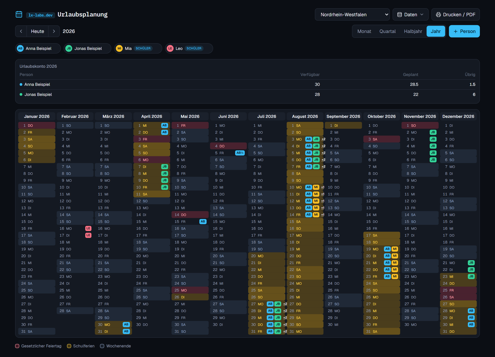
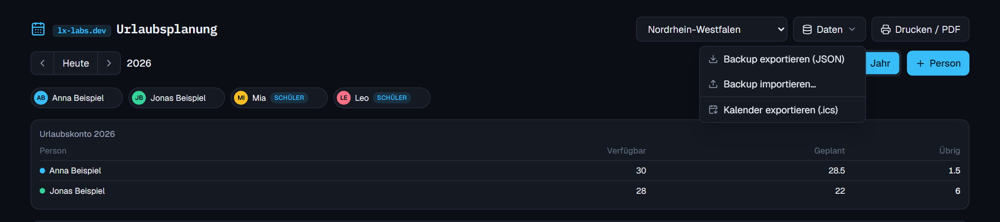

# Urlaubsplanung

Urlaubs- und Ferienplaner für Familien und kleine Teams: Jahresplaner mit gesetzlichen Feiertagen und
Schulferien je Bundesland, Urlaubskonto pro Person und Export in den eigenen Kalender.

Ein Projekt von [lx-labs.dev](https://lx-labs.dev).



## Funktionen

- **Kalenderansichten** Monat, Quartal, Halbjahr und Jahr im Jahresplaner-Stil; Urlaub per Klicken und Ziehen eintragen
- **Feiertage und Schulferien** für alle 16 Bundesländer (Daten: [Nager.Date](https://date.nager.at) und
  [OpenHolidays API](https://www.openholidaysapi.org))
- **Urlaubskonto** je Person (verfügbar, geplant, übrig): Wochenenden und Feiertage zählen nicht mit, halbe Tage
  sind möglich, 24.12. und 31.12. wahlweise als halbe Tage
- **Schüler-Status** für Kinder, die kein Urlaubskonto brauchen
- **Drucken / PDF** im Querformat
- **Backup** als JSON exportieren und wieder importieren (zusammenführen oder ersetzen)
- **Kalender-Export (.ics)** für Outlook, Google oder Apple Kalender



## Wichtig: kein Login

Die App hat bewusst keine Benutzerverwaltung. Wer sie erreicht, kann alle Einträge sehen, ändern und löschen.
Betreibe sie deshalb nur im eigenen Netz oder hinter einem Zugangsschutz (z. B. Reverse-Proxy mit Basic Auth) –
nicht offen im Internet.

## Schnellstart mit Docker

```bash
git clone https://github.com/diy3d-de/lx-labs-urlaubsplanung.git
cd lx-labs-urlaubsplanung
docker compose up -d
```

Danach läuft die App unter <http://localhost:3000>. Die Datenbank liegt im Docker-Volume `urlaubsplanung-data`.

## Installation ohne Docker

Voraussetzung: Node.js 20 oder neuer.

```bash
git clone https://github.com/diy3d-de/lx-labs-urlaubsplanung.git
cd lx-labs-urlaubsplanung
npm ci
cp .env.example .env
npx prisma generate
npx prisma migrate deploy   # legt die SQLite-Datenbank prisma/dev.db an
npm run build
npm run start               # Standard-Port 3000, änderbar über PORT
```

Für die Entwicklung reicht nach `npx prisma migrate deploy` ein `npm run dev`.

**Zum Ausprobieren:** Die Datei [`docs/beispieldaten.json`](docs/beispieldaten.json) enthält erfundene Personen und
Urlaube. Sie lässt sich über **Daten → Backup importieren** einspielen.

## Desktop-App (Windows)

Die App lässt sich als eigenständige Windows-Anwendung mit Electron bauen. Sie startet den Server lokal auf
`127.0.0.1` mit einem zufälligen freien Port und ist damit von außen nicht erreichbar.

```bash
npm run desktop:deps   # einmalig: Abhängigkeiten des App-Verzeichnisses electron/ (electron-updater)
npm run icons          # nur nach Änderungen an electron/icon.svg
npm run desktop:dist   # Next-Build, Installer in dist/, danach Paketprüfung
npm test               # Tests (Updater, Release-Notes, Neustart-Wächter)
```

Ergebnis: `dist/lx-urlaubsplanung-Setup-<version>.exe`. Die Datenbank liegt unter
`%APPDATA%\lx-urlaubsplanung\urlaubsplanung.db`. Zum Testen ohne Installer:
`npm run desktop:prepare && npm run desktop:start`.

## Mobile-App (Android)

Die Flutter-App in [`mobile/`](mobile/) funktioniert eigenständig offline (eigene Datenbank auf dem Handy) und gleicht
sich optional mit einer Server-Installation im Heimnetz ab (Einstellungen → Server-Adresse, z. B.
`192.168.178.20:3000`). Kalender mit Feiertagen und Schulferien, Urlaubskonto und Personen wie in der Web-App.
Details zum Entwickeln und Bauen: [`mobile/README.md`](mobile/README.md).

## Release & OTA-Updates

Beide Apps aktualisieren sich aus den öffentlichen Releases dieses Repos (kein Token nötig):

- **Desktop:** prüft 15 Sekunden nach dem Start und danach alle 6 Stunden, lädt ein Update im Hintergrund und
  installiert nur per Klick auf **„Update v… bereit“ → „Jetzt neu starten und installieren“**. Solange ein Dialog offen
  ist oder ein Import läuft, ist die Installation gesperrt. Protokoll: `%APPDATA%\lx-urlaubsplanung\update.log`.
- **Android:** prüft kurz nach dem Start und beim Zurückkehren in die App (höchstens alle 6 Stunden). Unter
  **Einstellungen → App-Version** erscheinen Version und Release-Notes; herunterladen, Prüfsumme prüfen und
  installieren passiert auf Tippen. Android verlangt einmalig die Erlaubnis „Apps aus dieser Quelle zulassen“ und
  installiert ein Update nur, wenn es mit demselben Schlüssel signiert ist.

**Neue Version veröffentlichen:**

1. Version in `package.json` erhöhen (`npm version 0.3.0 --no-git-tag-version` passt auch `package-lock.json` an),
   committen. Die Android-Version wird daraus abgeleitet (versionCode = Major·10000 + Minor·100 + Patch).
2. `git tag v0.3.0 && git push origin main v0.3.0`
3. Der Workflow `Release` baut und testet beide Apps, prüft das Desktop-Paket und legt **einen Release-Entwurf** mit
   Installer, `.blockmap`, `latest.yml`, APK und `.apk.sha256` an. Entwurf prüfen.
4. Release-Notes im Format von [`docs/release-notes-vorlage.md`](docs/release-notes-vorlage.md) schreiben und
   veröffentlichen: `gh release edit v0.3.0 --draft=false --latest --notes-file notes.md`. Erst jetzt sehen
   installierte Apps das Update.

Manuell gestartet (Actions → Release → Run workflow) baut der Workflow nur und legt Installer und (debug-signierte)
APK als Artefakte ab.

**Android-Signaturschlüssel (einmalig):** Der Workflow braucht vier Repository-Secrets: `ANDROID_KEYSTORE_BASE64`,
`ANDROID_KEYSTORE_PASSWORD`, `ANDROID_KEY_ALIAS`, `ANDROID_KEY_PASSWORD`. Den Schlüssel erzeugen und sicher aufbewahren
– **geht er verloren, lassen sich installierte Apps nicht mehr aktualisieren**:

```powershell
keytool -genkeypair -v -keystore lx-urlaubsplanung-upload.jks -keyalg RSA -keysize 4096 -validity 10000 -alias upload
[Convert]::ToBase64String([IO.File]::ReadAllBytes("lx-urlaubsplanung-upload.jks")) | gh secret set ANDROID_KEYSTORE_BASE64
gh secret set ANDROID_KEYSTORE_PASSWORD   # fragt den Wert ab
gh secret set ANDROID_KEY_PASSWORD
gh secret set ANDROID_KEY_ALIAS --body upload
```

**Stolpersteine:**

- Updates funktionieren nur mit dem NSIS-Installer. Die erste update-fähige Version muss einmal von Hand installiert
  werden.
- Release-Notes erscheinen im Update-Fenster ab der jeweils nächsten Version; angezeigt wird immer nur Text.
- „Update: Server prüfen“: GitHub fand kein veröffentlichtes Release (nur Entwürfe) oder das Abruflimit war erreicht.
- Ohne Code-Signing warnt Windows SmartScreen beim ersten Setup. Die Integrität sichert die SHA512-Prüfsumme in
  `latest.yml`; Schreibrechte auf dieses Repo daher eng halten.
- `scripts/pruefe-paket.cjs` vor jeder Veröffentlichung laufen lassen und immer das gepackte `dist/win-unpacked`
  testen, nie nur den Entwicklungsstart.

- Android: Den Signaturschlüssel nie verlieren oder wechseln; die `applicationId` (`dev.lx_labs.urlaubsplanung`)
  nie ändern.

**Datenschutz:** Für die Update-Prüfung rufen die Apps Server von GitHub ab (IP-Adresse und Programmversion gehen
dabei an GitHub); die Mobile-App holt außerdem Feiertage und Schulferien direkt bei Nager.Date und der OpenHolidays
API. Desktop: Update-Prüfung abschalten mit der Umgebungsvariablen `LX_URLAUBSPLANUNG_KEINE_UPDATES=1`.

## Abgleich mit Mobilgeräten

`POST /api/sync` gleicht Personen, Urlaube und das Bundesland mit der Mobile-App ab (Protokoll in
[`src/lib/sync.ts`](src/lib/sync.ts)). Der Server führt dafür einen Änderungszähler (SQLite-Trigger, Migration
`sync`); gelöschte Einträge werden als Tombstones gemerkt, damit Geräte Löschungen übernehmen. Wurde ein Eintrag auf
dem Server geändert, während ein Gerät offline eine eigene Änderung hatte, gewinnt der Server; Löschungen gewinnen
immer.

Wie die übrige App hat die Schnittstelle **keinen Login** – nur im eigenen Netz betreiben. Zwischen Handy und Server
gehen Namen und Abwesenheiten unverschlüsselt über das WLAN; wer das vermeiden will, stellt einen Reverse-Proxy mit
TLS (z. B. Caddy) davor.

**Erlaubte Hostnamen:** Gegen DNS-Rebinding beantwortet die API nur Anfragen an IP-Adressen, `localhost`, Namen ohne
Punkt (z. B. `nas`) und lokale Zonen (`.local`, `.lan`, `.home.arpa`, `.fritz.box` …). Läuft die App unter einem
eigenen Domainnamen, diesen in `ALLOWED_HOSTS` eintragen (kommagetrennt, ohne Port).

## Konfiguration

| Variable | Zweck | Standard |
| --- | --- | --- |
| `DATABASE_URL` | Datenbank für die Prisma-CLI (Migrationen) | `file:./dev.db` (= `prisma/dev.db`) |
| `SQLITE_PATH` | Datenbankdatei der laufenden App | `prisma/dev.db` |
| `PORT` | HTTP-Port | `3000` |
| `ALLOWED_HOSTS` | Zusätzlich erlaubte Hostnamen der API (kommagetrennt), z. B. `urlaub.example.de` | – |

## Datensicherung

Alle Daten liegen in einer SQLite-Datei. Über **Daten → Backup exportieren** lässt sich jederzeit eine JSON-Sicherung
herunterladen und später wieder einspielen.

## Technik

Next.js 16 · React 19 · Tailwind CSS 4 · Prisma 6 mit SQLite (better-sqlite3) · date-fns · lucide-react

## Lizenz

[MIT](LICENSE)
